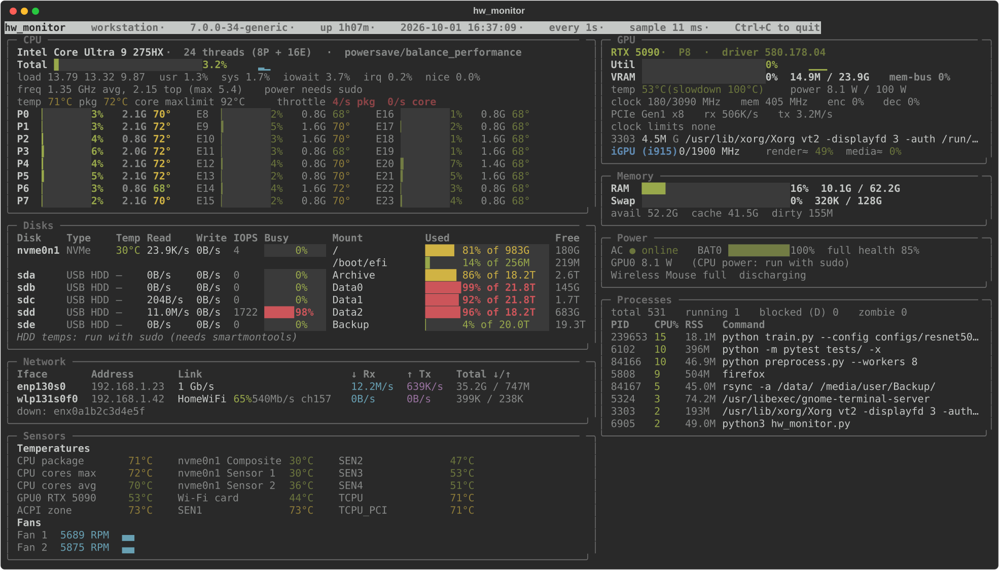

# hw_monitor

A single-file, live terminal dashboard for Linux laptops and workstations:
CPU, NVIDIA and Intel GPUs, memory, disks, network, every temperature sensor,
fans and power, plus alerts for serious kernel events such as GPU Xid errors,
kernel oopses and machine checks. Everything can be logged to CSV, for example
to find out why a machine throttles, overheats or crashes during long jobs.



## Features

- **CPU**: total and per-core load, clock and temperature (P/E cores on hybrid
  Intel CPUs), load average, package power (RAPL, needs root), the thermal
  throttle point (TjMax minus the firmware's TCC offset), thermal-throttle event
  rates, and a warning when busy cores are forced below the OS minimum clock
  (PROCHOT / embedded-controller limits).
- **NVIDIA GPUs**: utilization, VRAM, temperature vs. slowdown threshold, power
  vs. limit, clocks, P-state, PCIe link and throughput, encoder/decoder load,
  clock-limit reasons (power cap, thermal, HW slowdown) and per-process VRAM.
  Flags GPUs that are lost or need a reset. Data is read straight from NVML via
  `ctypes`, with no `nvidia-smi` subprocess per refresh, and a GPU in runtime
  suspend (D3) is left asleep.
- **Intel iGPU**: frequency, approximate busy % (from RC6 residency) and
  frequency-limit reasons (`i915` and `xe` drivers).
- **Memory**: RAM, swap, page cache, dirty and writeback pages.
- **Disks**: read/write throughput, IOPS, busy %, NVMe temperatures and usage of
  every mounted filesystem. With root and smartmontools it also shows SATA/USB
  hard-drive temperatures, without waking sleeping drives.
- **Network**: per-interface rates and totals, link speed, Wi-Fi SSID, signal and
  bit rate (NetworkManager), and an optional latency probe.
- **Sensors**: every hwmon and thermal-zone temperature, and all fan speeds
  with sparklines.
- **Power**: AC state; battery charge, draw, time left and health; peripheral
  batteries (mice, keyboards).
- **Processes**: top CPU consumers and counts of running, blocked (D-state) and
  zombie processes.
- **Alerts**: serious kernel messages since boot and kernel taint flags. Covers
  NVIDIA Xid errors, `kernel BUG` / `Oops`, machine-check and PCIe AER errors,
  hung tasks, OOM kills and disk I/O errors. The panel only appears when there is
  something to report.

Two design choices make it dependable when the hardware isn't:

- **It doesn't freeze on hung hardware.** Anything slow or hang-prone runs on
  background threads: NVML, `smartctl`, `statfs`, the journal and the `/proc`
  scan. When the GPU stops answering, NVML calls block for seconds each, but the
  dashboard and the log keep updating and say what is stuck.
- **The log survives crashes.** The CSV log is `fsync`ed every 5 s. After a hard
  crash or power loss it still holds the readings up to the last few seconds.

## Requirements

- Linux (everything is read from `/proc` and `/sys`)
- Python 3.9+
- [psutil](https://github.com/giampaolo/psutil) and [rich](https://github.com/Textualize/rich)

Optional, used when present:

| For | Needs |
|---|---|
| NVIDIA GPU data | the NVIDIA driver (`libnvidia-ml.so.1` ships with it) |
| Wi-Fi details | NetworkManager (`nmcli`) |
| Alerts panel | `journalctl` and membership of the `adm` or `systemd-journal` group |
| CPU package power | root (RAPL energy counters are root-only since CVE-2020-8694) |
| SATA/USB HDD temperatures | root and smartmontools (`smartctl`) |

## Installation

```sh
git clone https://github.com/zhou436/hw_monitor.git
cd hw_monitor
pip install -r requirements.txt        # or: conda install psutil rich
./hw_monitor.py
```

There is nothing to build. You can copy `hw_monitor.py` anywhere on your `PATH`.

## Usage

```sh
./hw_monitor.py                      # live dashboard, refreshed every second (Ctrl+C quits)
./hw_monitor.py -i 2                 # refresh every 2 s
./hw_monitor.py --sections cpu,gpu   # only some panels (cpu gpu mem disk net sensors power procs)
./hw_monitor.py --ping               # also time a TCP handshake to 1.1.1.1:443 every 5 s
./hw_monitor.py --once               # print one snapshot and exit
./hw_monitor.py --no-ui              # one compact text line per refresh
./hw_monitor.py --log hw.csv         # dashboard + append one CSV row per refresh
```

Other options: `--bits` shows network rates in bit/s, `--all-nics` also lists
interfaces that are down, and `--no-smart` never calls `smartctl`. See
`./hw_monitor.py --help`.

### Running as root

Plain `sudo ./hw_monitor.py` usually starts the system Python, which may not have
psutil and rich, because `sudo` resets `PATH`. Name the interpreter instead:

```sh
sudo "$(command -v python3)" hw_monitor.py
```

Root adds CPU package/core power and hard-drive temperatures. Everything else
works as a normal user.

### Logging to CSV

For long runs, such as an overnight training job, log in the background so the
log survives closing the terminal:

```sh
nohup ./hw_monitor.py --no-ui --log ~/hw_$(date +%F).csv -i 2 > /dev/null 2>&1 &
# or inside tmux / screen:  ./hw_monitor.py --no-ui --log hw.csv -i 2
```

Each row has a timestamp plus about 150 columns on a typical laptop, about 0.7 kB
per row, which is roughly 30 MB per day at `-i 2`. The columns cover:

- CPU: per-core load and temperatures, clocks, package temperature, thermal
  limit, throttle rates
- GPU: utilization, VRAM, temperature, power, clocks, PCIe throughput and clock
  limits; `gpu<N>_error` holds "GPU is lost" or a pending recovery action
- Disks and network: throughput per disk and per interface; filesystem usage
- Sensors and power: every temperature and fan speed, battery state
- Kernel: `kernel_events`, the number of serious kernel messages this boot, and
  `kernel_taint`, the kernel taint flags

When appending to an existing file, its header is kept. Columns that appear
later, such as a drive plugged in after the start, are left out of that file.

### Colours

Values turn yellow, then red, at these thresholds:

| Reading | Yellow from | Red from |
|---|---|---|
| CPU temperature | 70 °C | 90 °C, or 2 °C below the throttle point |
| NVIDIA GPU temperature | 70 °C | 85 °C, or 5 °C below the slowdown temperature |
| NVMe temperature | 55 °C | 70 °C |
| HDD temperature | 45 °C | 55 °C |
| Other sensors | 60 °C | 80 °C, or 5 °C below the sensor's critical point |

## Notes and limitations

- It is a monitor only: it never changes fan speeds, clocks or power limits.
- AMD GPUs have no dedicated panel, but their hwmon temperatures and fans do
  appear under Sensors. AMD CPUs report temperatures through
  `k10temp`/`zenpower`.
- Laptop fans exposed through ACPI have no names, so they are shown as Fan 1,
  Fan 2, and so on.
- The Intel iGPU busy % is derived from RC6 (idle-state) residency. It is the
  only activity counter readable without root, so it is an approximation (≈).
- Tested on Ubuntu 24.04 (Linux 7.0, Python 3.13, rich 14, psutil 7) with an
  Intel Core Ultra 9 275HX and an NVIDIA GeForce RTX 5090 Laptop GPU (driver
  580). Bug reports from other hardware are welcome.

## License

[MIT](LICENSE). The dependencies are psutil (BSD-3-Clause) and rich (MIT). NVIDIA's
NVML library is loaded at run time from the installed driver and is not
distributed with this project.

## Acknowledgements

Developed with the help of AI coding tools.
